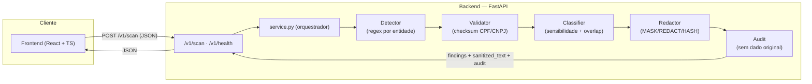

# Data Guardian

Motor de detecção, classificação e mascaramento de dados pessoais, criado para apoiar empresas na conformidade com a LGPD.

Dado um texto, o Data Guardian identifica dados pessoais (CPF, CNPJ, e-mail, telefone, CEP, cartão de crédito, RG e, de forma limitada, nome e endereço), classifica a sensibilidade de cada um e aplica uma política de mascaramento configurável (`MASK`, `REDACT`, `HASH`). A detecção é determinística, auditável, e o dado original nunca é gravado no log de auditoria.

**Versão atual:** `v1.0.0` · [Release no GitHub](https://github.com/Marcos00000007/DataGuardian/releases/tag/v1.0.0)

## Equipe

| Nome | RA | Frente |
|------|----|--------|
| Marcos André Camargo Belo | 22510865 | Integração, arquitetura, empacotamento e release |
| João Paulo Rodrigues de Oliveira | 22508370 | Testes, cobertura, especificação As-Built e análise de IA |
| Pedro Henrique Barbosa | 22503467 | Governança, revisão de PRs, retrospectiva e vídeo |

## Documentação

| Documento | Conteúdo |
|-----------|----------|
| [`docs/SPECIFICATION.md`](docs/SPECIFICATION.md) | Especificação técnica: contratos, regras de negócio e registro de refinamento |
| [`docs/RELATORIO_TESTES_E_ANALISE_IA.md`](docs/RELATORIO_TESTES_E_ANALISE_IA.md) | Relatório de testes, loop de re-especificação, comparativo e ética de IA |
| [`docs/RETROSPECTIVA.md`](docs/RETROSPECTIVA.md) | Retrospectiva do grupo |
| [`docs/adr/`](docs/adr/) | Decisões arquiteturais (ADRs) |
| [`CLAUDE.md`](CLAUDE.md) | Regras do agente de IA no fluxo SDD |

## Stack

- **Backend:** Python 3.11 + FastAPI + Pydantic
- **Frontend:** React + TypeScript + Vite + Tailwind CSS
- **Infraestrutura:** Docker + Docker Compose
- **Testes:** pytest + httpx (TestClient) + pytest-cov

## Arquitetura

Um frontend de demonstração consome uma API HTTP. O núcleo do backend é um pipeline de estágios independentes, orquestrados por `service.py`, cada um testável isoladamente.



Detalhes de contratos e regras de negócio estão em [`docs/SPECIFICATION.md`](docs/SPECIFICATION.md).

## Como rodar

**Pré-requisito:** Docker e Docker Compose instalados. Nenhum outro programa é necessário.

```bash
git clone https://github.com/Marcos00000007/DataGuardian.git
cd DataGuardian
docker-compose up --build
```

- **Interface (frontend):** http://localhost:5173
- **API (backend):** http://localhost:8000 · documentação interativa em http://localhost:8000/docs

Para parar: `Ctrl+C` e depois `docker-compose down`.

### Variáveis de ambiente (opcional)

Todas têm valor padrão, então o `.env` só é necessário se alguma porta já estiver em uso na sua máquina.

| Variável | Padrão | Função |
|----------|--------|--------|
| `BACKEND_PORT` | `8000` | Porta do host para a API |
| `FRONTEND_PORT` | `5173` | Porta do host para a interface |

```powershell
# Windows (PowerShell)
Copy-Item .env.example .env
# edite o .env e troque as portas desejadas, depois:
docker-compose up --build
```

```bash
# Linux / macOS
cp .env.example .env
```

### Testando a API rapidamente

Health check:

```bash
curl http://localhost:8000/v1/health
# {"status":"ok"}
```

Varredura de um texto (Linux/macOS):

```bash
curl -X POST http://localhost:8000/v1/scan \
  -H "Content-Type: application/json" \
  -d '{"text":"Meu CPF e 123.456.789-09 e meu email e ana@empresa.com","config":{"entities":["CPF","EMAIL"],"strategy":"MASK"}}'
```

No Windows (PowerShell):

```powershell
Invoke-RestMethod -Method Post -Uri http://localhost:8000/v1/scan -ContentType "application/json" `
  -Body '{"text":"Meu CPF e 123.456.789-09 e meu email e ana@empresa.com","config":{"entities":["CPF","EMAIL"],"strategy":"MASK"}}'
```

Resposta esperada (resumida):

```json
{
  "findings": [
    {"type": "CPF",   "value_masked": "***.***.***-09", "start": 10, "end": 24, "sensitivity": "ALTA",  "valid": true},
    {"type": "EMAIL", "value_masked": "***@empresa.com", "start": 39, "end": 54, "sensitivity": "MEDIA", "valid": true}
  ],
  "sanitized_text": "Meu CPF e ***.***.***-09 e meu email e ***@empresa.com",
  "audit": {"timestamp": "...", "total_findings": 2, "strategy_applied": "MASK"}
}
```

## Rodando os testes (Test Harness)

Um único comando sobe o ambiente de teste, roda toda a suíte e mostra a cobertura de código:

```bash
docker-compose run --rm tests
```

O serviço `tests` não publica portas, então roda mesmo que a 8000 esteja ocupada. A saída termina com o resumo `N passed` e a tabela de cobertura por módulo.

Para guardar o resultado em arquivo (PowerShell):

```powershell
docker-compose run --rm -T tests | Out-File -Encoding utf8 pytest_log.txt
```

Sem Docker (opcional):

```bash
cd backend
pip install -r requirements-dev.txt
pytest -v --cov=app --cov-report=term-missing
```

## Estrutura de branches e governança

- `main` — protegida; só recebe Pull Request aprovado por outro membro. Cada versão estável recebe uma tag de release.
- `develop` — integração das features antes de ir para a `main`.
- `feature/*` — uma branch por tarefa/issue.

Todo PR segue o [template](.github/PULL_REQUEST_TEMPLATE.md), com critérios de aceitação e checklist.

## Agentes de IA no fluxo de desenvolvimento

O projeto segue SDD (Spec-Driven Development): a geração de código com IA parte da especificação, e as regras de contexto do agente ficam versionadas em [`CLAUDE.md`](CLAUDE.md). Toda saída do agente deve passar por revisão humana e pelos testes antes do merge. A análise comparativa de ferramentas e a discussão ética estão em [`docs/RELATORIO_TESTES_E_ANALISE_IA.md`](docs/RELATORIO_TESTES_E_ANALISE_IA.md).

## Registro de Decisões Arquiteturais (ADRs)

| ADR | Título | Status |
|-----|--------|--------|
| [0001](docs/adr/0001-deteccao-deterministica.md) | Detecção via regras determinísticas (não ML) | Aceita |
| [0002](docs/adr/0002-stack-tecnologica.md) | Escolha da stack tecnológica | Aceita |
| [0003](docs/adr/0003-consolidacao-dependencias.md) | Consolidação das dependências Python | Aceita |
| [0004](docs/adr/0004-imagem-unica-e-servico-de-testes.md) | Imagem única do backend e serviço de testes no Compose | Aceita |

## Limitações conhecidas

As principais: detecção de nome e endereço é limitada a formatos simples; o `HASH` é um SHA-256 truncado e sem sal (não use para dados de baixa entropia como CPF se a ideia for impedir reversão); CORS está aberto (`*`) para a demonstração; a API não tem autenticação.